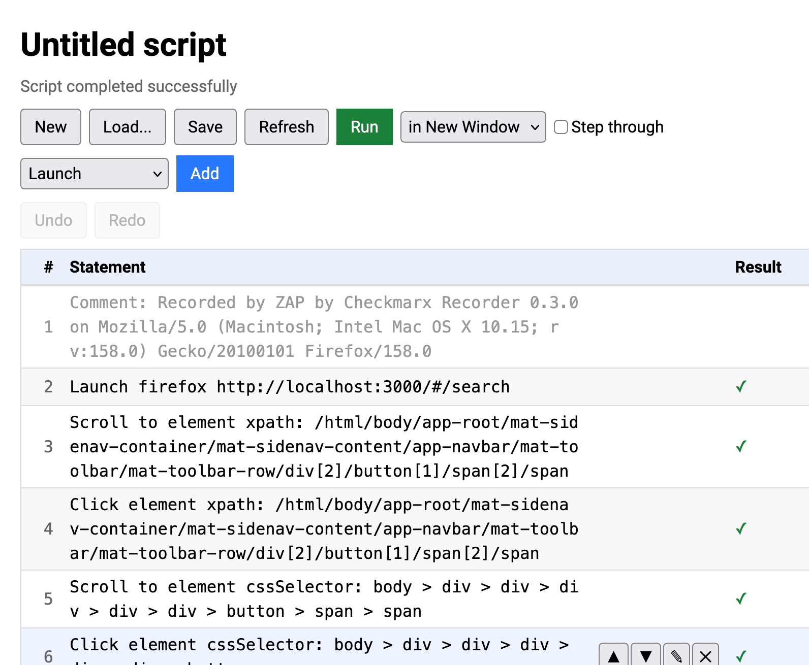
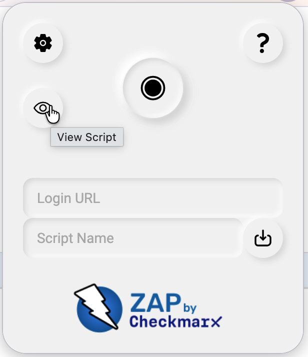
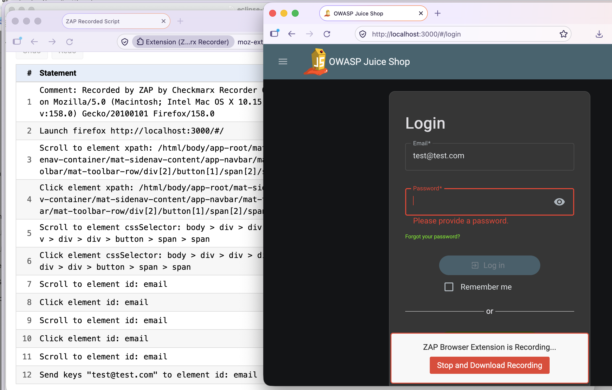
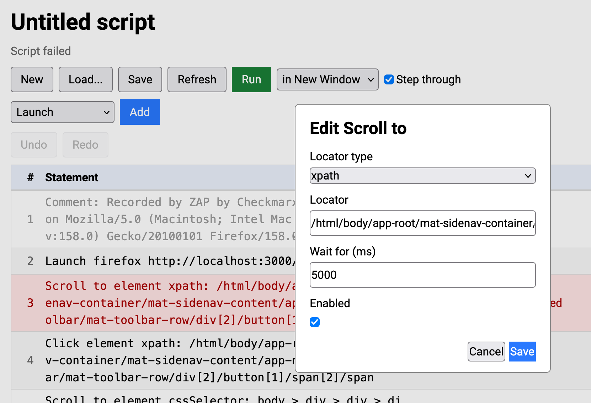
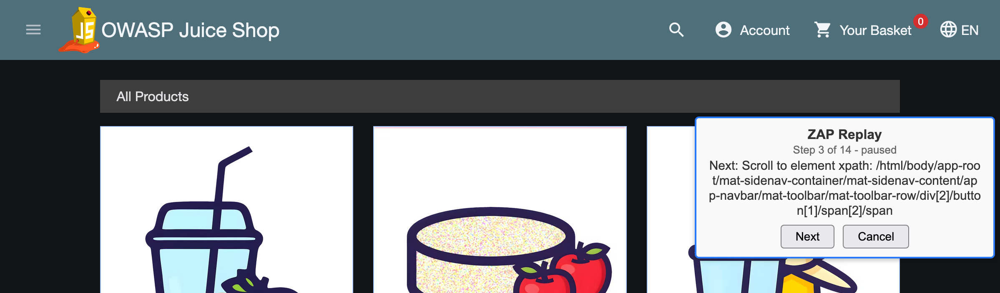

## Scripts you can see, change, and replay

You can now record a login or business flow with the ZAP Browser Extension, check that it works, fix it and replay it,
all without leaving the browser.

The [ZAP Browser Extension](https://github.com/zaproxy/browser-extension/) has always been able to
[record your actions as a Zest script](/docs/desktop/addons/client-side-integration/record/).
Until now that script was a black box: you recorded it, downloaded it, and found out if it worked later.

Version 0.3.0 changes that with the new **Script Viewer**, which lets you see, edit and replay the [Zest](/docs/desktop/addons/zest/) script.
It is available in both the full extension and the standalone Recorder.

## Opening the viewer

Click the new **View Script** button in the extension popup and the script opens in its own tab.
If the tab is already open you are just switched to it.

The viewer also opens in a background tab as soon as you start recording, without taking you away from the page
you are recording.

## Watching a recording

While you are recording, the viewer shows your script building up statement by statement and scrolls to keep the
latest one in view.
Editing and replaying are disabled until you stop recording.

## Editing

Each statement is shown in a summary form similar to the one used in the ZAP desktop.
Hover over a row to show its buttons, which let you:

- **Edit** the statement, including the locator used to find the element
- **Move** it up or down
- **Delete** it (you are asked to confirm first)

You can also add new statements of any type the extension supports using the pulldown with the **Add** button,
**Undo** and **Redo** your changes.

The locator types you can choose from are `id`, `cssSelector`, `xpath`, `className`, `name`, `linkText`,
`partialLinkText` and `tagName`.
The recorder will not record `partialLinkText` itself, but you can switch a statement to use it and it
will be used when the script is replayed.
This is handy when the text of a link varies slightly, for example when it includes a counter.

## Replaying

Select **Run in New Window** or **Run in New Tab** and the extension replays the script in the browser.
While it runs, a small box on the page shows which statement is being run.
You can move it out of the way and it does not affect the replay.

If you want to see exactly what is happening, tick **Step** and the script will run one statement at a time,
waiting for you to press **Next** (or **Cancel** to stop).

The replay uses the same logic for finding elements and sending keystrokes that the recorder
captured, so it is a quick way to check that a recorded login or workflow is robust before you use it in ZAP.
Replaying is not available while you are recording.

## Loading and saving

Use **Load** to open a Zest script from disk, and **Save** to download the current one.
**New** clears the script (after asking you to confirm).
This means you can also use the viewer to tidy up a script recorded earlier, or one created elsewhere.

## Things to be aware of

- Only the statement types that the extension can record and replay are supported.
  Scripts that use other features, such as conditional statements or loops, are rejected when loaded.
- Edits are made to the script held in the browser, they are not sent back to ZAP while you work.
- Replaying only works with `http` and `https` pages.

## Try it out

Update to version 0.3.0 of the full extension or the Recorder, record something, and click **View Script**.

If you are launching your browser from ZAP then update the [Client Side Integration](/docs/desktop/addons/client-side-integration/) add-on.

If you are manually installing the Recorder in your browser then update that from the relevant 
[browser marketplace](/docs/desktop/addons/client-side-integration/record/).

The built in help has a new Script Viewer section describing everything above.

We would love your feedback, in particular on what other statements or editing options you would find useful.
Please let us know via the [ZAP User Group](https://groups.google.com/group/zaproxy-users)
or by raising an issue in the [browser extension repository](https://github.com/zaproxy/browser-extension/issues).
