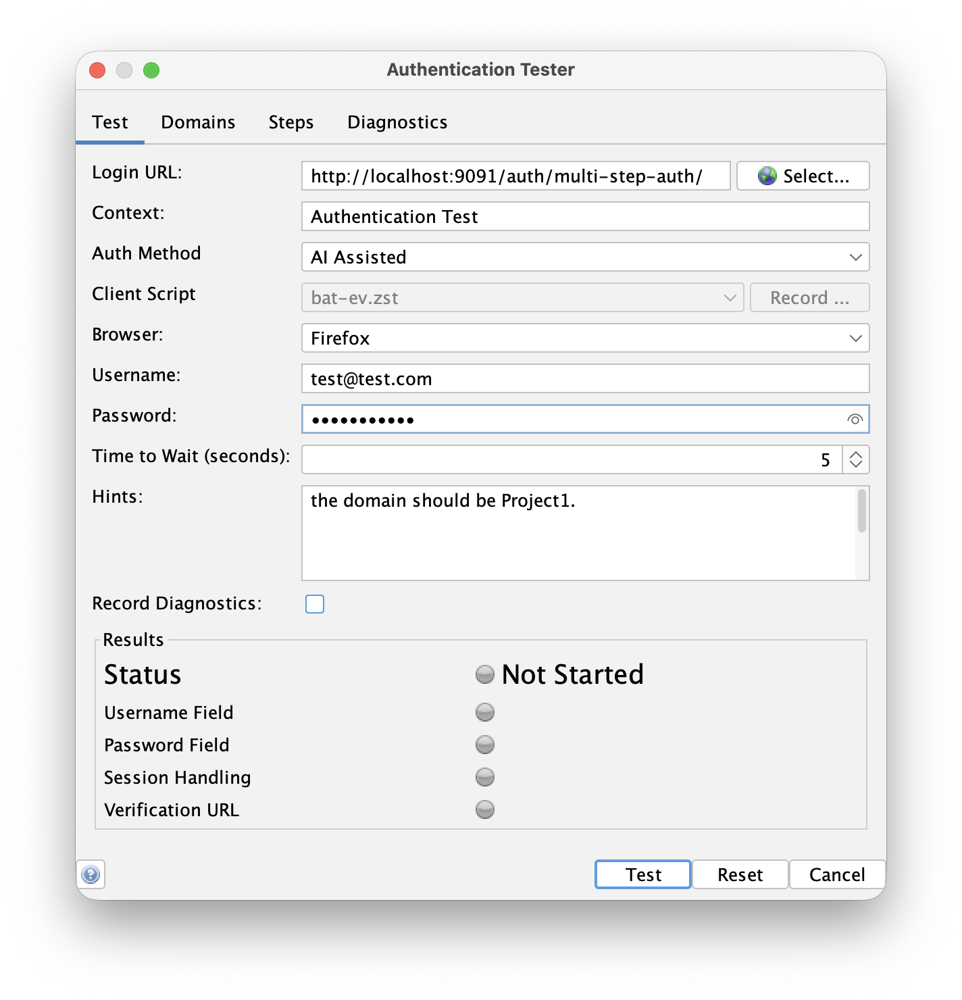
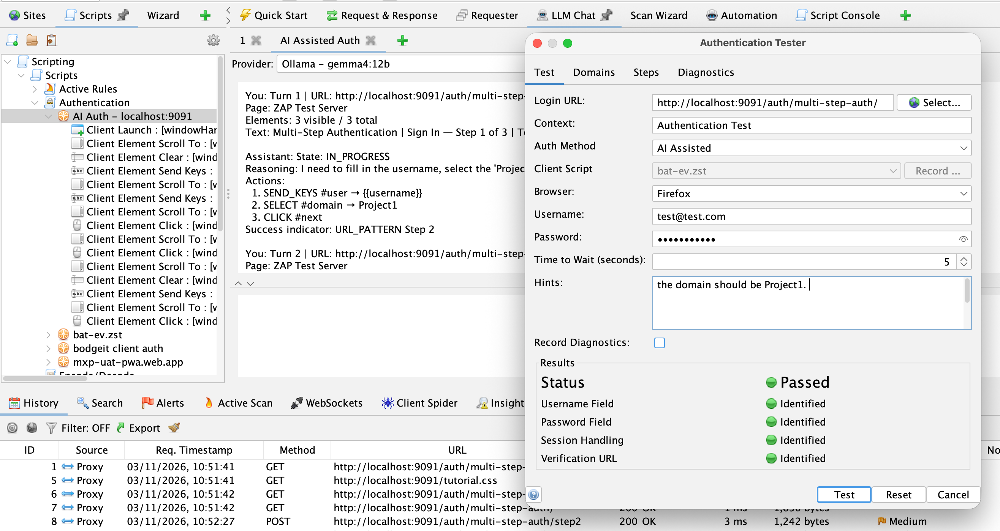

## Authentication is hard

Handling authentication for modern web apps is one of the hardest parts of getting a good scan.
Single page apps, multi-step logins, redirects through identity providers, tokens stored in odd places,
cookie banners that get in the way... there are a lot of ways for things to go wrong.

We **do not recommend** that you configure authentication in ZAP manually, i.e. by working out which requests
to send, which fields to set, and how to identify a logged in session by hand.
It is time consuming, fragile, and it does not work well with the modern spiders, which need to be able to
authenticate in a real browser.

Instead we recommend one of the two methods provided by the
[Authentication Helper add-on](/docs/desktop/addons/authentication-helper/):

- [**Browser Based Authentication**](/docs/desktop/addons/authentication-helper/browser-auth/) -
  ZAP launches a browser, loads your login page, and uses heuristics to find the username and password fields
  and submit the form. You supply the login page URL and credentials, and ZAP does the rest, including working out
  how your app handles sessions and how to verify that you are logged in. This works for a large number of apps.
- [**Client Script Authentication**](/docs/desktop/addons/authentication-helper/client-script/) -
  for apps where the heuristics are not enough, you record your login with the browser extension or
  the Authentication Tester, and ZAP replays that [Zest](/docs/desktop/addons/zest/) script whenever it
  needs to authenticate. You have full control, and the replay is fast and deterministic.

## Introducing AI Assisted Authentication

The new **AI Assisted Authentication** method sits between those two. It uses an LLM to drive the browser
and log in for you, even when the login flow is something the Browser Based heuristics cannot handle.

At each step ZAP sends the LLM a description of the current page: the URL, the title, the visible text and the form
elements. The LLM decides what to click, type or select next, and ZAP carries out that action in the browser.
This repeats until the LLM decides that the login has succeeded or failed, or a maximum number of turns is reached.

The clever part is what happens next. Running an LLM on every authentication attempt would be slow, costly and
non-deterministic. So AI Assisted Authentication is only meant to be used **once**, to work out how to log in.
While it runs, ZAP records every action that succeeds. When the login works, ZAP automatically:

1. Builds a Zest script from the recorded actions
1. Switches your context to [Client Script Authentication](/docs/desktop/addons/authentication-helper/client-script/) using that script

All of the subsequent authentication attempts then use the generated script, with no LLM involved.
You can also review, test, or edit the script just like any other Client Script.

### Your credentials stay with ZAP

**ZAP does not send your credentials to the LLM.** The LLM is only given placeholders for the username and password,
and tells ZAP which field each one should go into. ZAP then fills in the real values locally in the browser.
Any real credential values that appear in the page elements are also replaced with the placeholders before they are sent.

### What you need

- The latest version of the [Authentication Helper add-on](/docs/desktop/addons/authhelper/)
- The [LLM Support add-on](/docs/desktop/addons/llm-support/), configured with a working LLM provider

Note that the description of each page that is sent to the LLM includes the page text, and this is sent regardless of
the provider's [Trusted](/docs/desktop/addons/llm-support/options/) setting.
So choose a provider you are happy to share this with. A locally hosted model is a good option if you have concerns.

## Trying it out with the Authentication Tester

The easiest way to try this out is with the [Authentication Tester](/blog/2023-05-23-authentication-tester/), which is available from the
**Tools** menu (or the `Ctrl+T` shortcut, `Cmd+T` on macOS).



1. Make sure the LLM Support add-on is configured with a provider
1. Open the **Authentication Tester**
1. Enter the **Login URL** of your app
1. Select **AI Assisted** as the **Auth Method**
1. Select the **Browser** you want to use
1. Enter the **Username** and **Password**
1. If your login has steps which are not obvious from the page itself, enter some guidance in the **Hints** field,
   for example: `Set the domain dropdown to Project1 before clicking Next.`
1. Press the **Test** button and watch ZAP work through your login

Hints are the main way to help when the LLM gets stuck. Things like which option to choose in a dropdown,
or how to dismiss a particular cookie banner, are very difficult to infer from the page alone.

The results panel shows the progress and what has been identified, as with the other methods.
If it succeeds, ZAP will have worked out the session handling and verification as well, and your context will have been
switched over to Client Script Authentication using the script it just generated.

You can follow what the LLM is doing as it happens: all of the interactions with the LLM are shown in an
**AI Assisted Auth** tab in the [LLM Chat tab](/docs/desktop/addons/llm-support/chat/). For each step you can see the page
that ZAP described, the actions the LLM chose and its reasoning for them, which is very useful when you are working out
what hints to give it, or why a login failed. Remember that the credentials only ever appear there as placeholders.



## Automating AI Assisted Authentication

You can also use the method outside of the Authentication Tester:

- In the [Automation Framework](/docs/desktop/addons/authentication-helper/automation/) set the authentication `method` to `ai`
- Via the API using the `aiAssistedAuthentication` action in the `authentication` API

An example Automation Framework plan which configures an LLM provider and then uses the `ai` method looks like:

```yaml
env:
  contexts:
  - name: "ai-auth-context"
    urls:
    - "https://www.example.com"
    includePaths:
    - "https://www\\.example\\.com.*"
    authentication:
      method: "ai"
      parameters:
        loginPageUrl: "https://www.example.com/login"
        browserId: "firefox-headless"
        loginPageWait: 5
        hint: "Set the domain dropdown to Project1 before clicking Next."
      verification:
        method: "autodetect"
    sessionManagement:
      method: "autodetect"
    users:
    - name: "test-user"
      credentials:
        username: "test@example.com"
        password: "${AUTH_PASSWORD}"
jobs:
- type: llm-config
  parameters:
    defaultProvider: "my-provider"
    defaultModel: "my-model"
  providers:
  - name: "my-provider"
    type: "OPENAI_COMPATIBLE"
    apiKey: "${LLM_API_KEY}"
    endpoint: "https://llm.example.com/v1"
    models:
    - "my-model"
- type: "requestor"
  parameters:
    user: "test-user"
  requests:
    - url: "https://www.example.com/"
      method: "GET"
      responseCode: 200
```

Only `loginPageUrl` is mandatory, the `hint` is optional. The `llm-config` job is only needed if you have not already configured a provider in ZAP.
We recommend using environment variables for secrets, as shown above, so that they are not saved in the plan.

The `requestor` job sends a request as `test-user`, which triggers the authentication.
Once the authentication succeeds ZAP switches the context in the running ZAP instance to Client Script Authentication.
The plan itself is not changed though, so if you re-run it ZAP will use the LLM again.
To use the generated script instead you need to create a new plan that uses the updated context.

See the [AI Assisted Authentication help](/docs/desktop/addons/authentication-helper/ai-auth/) for all of the details.

## Choosing a model

The model you use makes a big difference. The LLM has to reliably follow instructions and respond with
structured output, across a number of turns, so our recommendations are:

- **Use a current, capable model.** The frontier models from the major providers do best, and we have had good results
  with the Claude, Gemini and OpenAI families. A mid-sized model from one of these families is usually plenty,
  you do not need the biggest and most expensive one.
- **Be wary of very small models.** Small models, including many that you can run locally, often struggle to
  produce valid structured responses or to choose the right element on a busy page.
  If you want to stay local then use the largest model your hardware can run, and expect to need more hints.
- **It is a one-off cost.** Because the result is converted into a script, you will only need the LLM
  when you first set up the authentication (or when the login page changes), so the token usage is small.
  It is worth using a better model, rather than burning time on retries with a poor one.

If a model fails, try a different one before spending a long time tuning your hints.

## What about TOTP?

Multi-factor authentication using Time-based One-Time Passwords (TOTP) is **not currently supported** by
AI Assisted Authentication. This is coming soon, so keep an eye on the
[ZAP blog](/blog/) for the announcement.

## Feedback

This is a new feature, and we want to hear how it works for you, especially on the login pages that Browser Based Authentication
could not handle. Please let us know how you get on in the [ZAP User Group](https://groups.google.com/group/zaproxy-users),
or raise an issue in the [zaproxy](https://github.com/zaproxy/zaproxy) repository if you find something that does not work.
