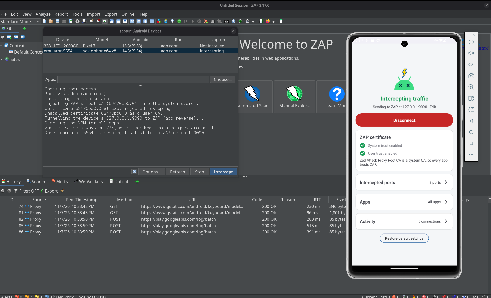
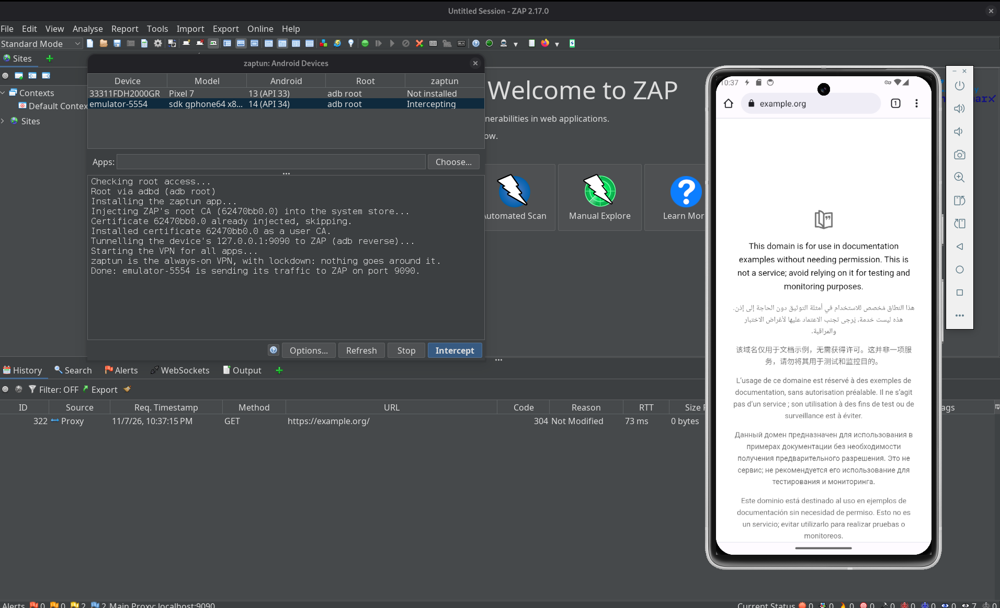

Testing Android apps with ZAP has always had two sticking points: getting the device to trust ZAP's
certificate, and getting *all* of the app's traffic to go through ZAP, including from apps that ignore the system proxy.

**[zaptun](/docs/desktop/addons/zaptun-adndroid-interception/)** is a ZAP add-on by [David Araújo](https://davidjosearaujo.dev/) that solves both. Pick a device in *Tools → Android Devices...*,
click **Intercept**, and every TCP connection the device makes goes through ZAP. It works with Android emulators
and rooted devices, and `adb`.
The rest of this post is David's own write-up of how it works, starting with why this is hard in the first place.

zaptun is available from the [ZAP Marketplace](/addons/#addon-zaptun), and the source is on Codeberg: [davidjosearaujo/zaptun](https://codeberg.org/davidjosearaujo/zaptun).

## Capturing everything is the hard part

Watching an Android app's traffic in ZAP sounds simple: point the device at ZAP as a proxy and read the requests. In practice, two things stand in the way, and both are a nuisance.

The first is **trust**. HTTPS traffic is only readable if the device trusts ZAP's root certificate, and on Android 14+ that's genuinely hard. System certificates no longer live in a folder you can write to; they're inside the **Conscrypt APEX** module, mounted read-only. Dropping a certificate into `/system/etc/security/cacerts` does nothing, because Android isn't looking there anymore.

The second is **routing**. Setting a system HTTP proxy only catches apps that bother to read it. Plenty don't: anything built on Flutter, OkHttp clients configured with `Proxy.NO_PROXY`, apps talking over raw sockets, malware that deliberately ignores the proxy to stay hidden. Set a proxy and you see the well-behaved half of the traffic and miss exactly the half you care about.

So the honest way to see **everything** is to put the device behind a VPN that forwards every TCP connection to ZAP, and to inject ZAP's certificate into the system store the hard way. Both are fiddly, both need root, and both have to be redone after every reboot. I'd done it by hand enough times to want a button instead.

**zaptun** is that button. It's a ZAP add-on: pick a device, click **Intercept**, and every byte the device sends goes through ZAP. It's roughly what [HTTP Toolkit's](https://httptoolkit.com/) "Android device via ADB" does, but for ZAP.

## One click in ZAP

The add-on adds a *Tools → Android Devices…* dialog that lists every device `adb` can see, with its Android version, how it can get root, and whether it's currently being intercepted. You pick one, optionally choose which apps to capture (all of them by default), and click **Intercept**. The add-on runs five steps over `adb`, logging each one:

1. **Installs the zaptun VPN app** on the device (the add-on bundles the APK and pushes it).
2. **Injects ZAP's root CA** into the system store, and also installs it as a user CA.
3. **Tunnels the device's `127.0.0.1:<port>` to ZAP** with `adb reverse`. On an emulator, the `10.0.2.2` host alias would work too, but its network adds about a second to every new connection, while the adb tunnel adds a few milliseconds.
4. **Starts the VPN**, after which every TCP connection on the device goes through ZAP.
5. **Makes zaptun Android's always-on VPN, with lockdown**, so nothing gets around ZAP even while the VPN restarts. More on that [below](#locking-the-door).

There's nothing to export, push or configure by hand. **Stop** turns lockdown off, then the VPN, and removes the tunnel.



It works headless too, driven from ZAP's API, which is handy in a script or CI:

```shell
## Intercept the only connected device (or pick one with serial=; apps= is optional)
curl "http://localhost:9090/JSON/zaptun/action/intercept/?apikey=$KEY&serial=emulator-5554"
curl "http://localhost:9090/JSON/zaptun/action/stop/?apikey=$KEY&serial=emulator-5554"
```

The easiest way to get the add-on is from the Marketplace, but you can also build it yourself. That takes one Gradle command and *File → Load Add-on File…*. Building it needs **only a JDK (17+), not the Android SDK**: the repo carries a prebuilt copy of the VPN app, and when no SDK is around, the build bundles that one into the add-on. With an SDK, it builds the app from source and bundles that instead, so a plain JDK container is enough to produce a working add-on.

```shell
./gradlew copyZapAddOn    # the .zap file lands in zap-addon/build/zapAddOn/bin/
```

The rest of this post is about how the interesting parts work: the VPN, how it hands ZAP real hostnames, how it stops traffic leaking around ZAP, and how the certificate gets in.

## A VPN, not a proxy

The device side of zaptun is an Android `VpnService`. Android lets an app declare itself a VPN and receive **every IP packet** the device tries to send, through a `tun` interface. That's the whole point: a VPN sees the Flutter app, the OkHttp client that refused the proxy, the raw socket and the malware, because none of them get a say. They just send packets, and the packets come to us.

The catch is that a VPN gives you **raw IP packets**, not connections. ZAP, on the other hand, speaks HTTP: it wants `CONNECT host:port` and a TLS stream, not a pile of TCP segments. So zaptun's job is to turn one into the other, connection by connection, and that's most of the code.

## How the tunnel works

Reassembling TCP from raw packets in userspace is a lot of work to get right (sequence numbers, retransmits, windows, the lot). zaptun sidesteps almost all of it with a trick: it rewrites each packet's headers so the connection lands on a **local socket**, and lets the **kernel's own TCP stack** do the hard part.

```
app ──► tun ──► TcpNat (header rewrite) ──► local relay ──► CONNECT host:port ──► ZAP
```

A small NAT table rewrites an outgoing packet from `app → real destination` into `fake address → local relay port`, and rewrites the replies back, so the app thinks it's talking to its real destination while the bytes actually arrive on a plain `ServerSocket` the relay is listening on. Because the relay is a normal socket, the kernel handles all the TCP machinery, and the relay just gets a clean byte stream. The original destination is remembered against the fake source port, so the relay can look up where each connection was really going.

For each connection the relay then decides a **route**. Only connections to the **intercepted ports** (80, 443, 8080 and a handful of other common web ports by default, editable in the app) are candidates for ZAP; a connection to anything else goes **straight to its destination**, untouched, so non-web protocols keep working. For an intercepted port, the relay peeks at the first bytes to work out what it's looking at, opens `CONNECT <host>:<port>` on ZAP, and pipes the stream through. ZAP sees a normal proxied connection; the app sees its server.

Some apps talk HTTP on ports nobody would guess. For those, the app has an **Also find HTTP on every other port** switch: the relay then gives every other connection half a second to show its first bytes, and sends plain HTTP, and TLS whose ClientHello offers HTTP through ALPN (`h2`, `http/1.1`), to ZAP as well. Other TLS (MQTT, IMAP, XMPP...) still goes direct, since ZAP would break it, and so does a protocol where the server speaks first, like SSH, once that half second is up.

## Giving ZAP real hostnames

If you just forwarded the raw bytes, ZAP would see connections to **IP addresses**, and its History and generated certificates would be full of `104.18.x.x` instead of hostnames. That's miserable to read and breaks name-based certificate generation. So before opening the tunnel, zaptun reads the start of the stream and pulls the hostname out of it:

- For **TLS**, it parses the ClientHello and takes the **SNI** (the `server_name` the client asks for).
- For **plain HTTP**, it takes the **`Host` header**.
- A request an app already addressed to a proxy (a `CONNECT` or an absolute-URI request, from an app honouring the system proxy) is handed to ZAP unchanged.
- Anything else, a protocol that isn't HTTP on a web port, or a server that speaks first, is sent **direct**, because there's no hostname to give ZAP and no point tunnelling it.

A detail that bit me: some clients (browsers especially) open a socket **well before** they send anything, then reuse it later. If the relay gave up after a second of silence and sent that socket direct, the connection would skip ZAP. So on an intercepted port the relay waits up to **30 seconds** for the first bytes before deciding, which keeps those early-opened sockets captured.

Closing is tracked per direction, too, and this one is subtle. ZAP drops a tunnel the moment its client half-closes it, **even if a reply is still on the way**. A naive relay that forwarded the app's half-close straight through would make ZAP hang up on responses the app was still owed. So when a connection is going to ZAP, zaptun **holds back the app's half-close** while the app is still waiting for a reply, and lets the connection end when ZAP itself closes it, once the exchange is actually over.

## Plugging the leaks

A VPN that only handles TCP cleanly will quietly leak the rest, and a leak is exactly what you don't want when you're trying to see everything. So zaptun deals with the awkward cases on purpose:

- **DNS** is forwarded to the real network's resolvers, over UDP and TCP, so name resolution keeps working while the VPN is up. **Private DNS** (DNS over TLS) is refused at once, so the device falls back to plain DNS that zaptun can see, instead of resolving names over a channel it can't read.
- **IPv6 isn't carried.** `AAAA` lookups come back empty so apps use IPv4, and an app that still tries IPv6 (an address literal, a cached record) gets an immediate reset rather than a long timeout. Everything then rides IPv4, where the tunnel lives.
- **QUIC** (HTTP/3) can't go through ZAP, so it's refused with an ICMP "port unreachable". That's every packet to UDP 443, and on any other port, a packet that looks like a QUIC client's very first one (a padded Initial of a known version). Clients take the hint and **fall back to TCP**, which ZAP does see. Every other UDP flow (calls, NTP, games) passes straight through uncaptured, because ZAP can't proxy UDP anyway, and breaking them would just make apps misbehave.

There's one more escape route, and it's a sneaky one. If the device has Android's **global HTTP proxy** set (some emulator setups and launch scripts do this), apps that honour it will send their traffic to that proxy and never meet the VPN at all. So while zaptun is connected it **switches the global proxy off**, and puts the old value back when you disconnect. Changing a secure setting needs a permission the add-on grants over `adb` when you click **Intercept**; on a Magisk-rooted phone it falls back to `su`. The one proxy it can't touch is the one set by the **emulator itself**, with its `-http-proxy` launch flag: that lives outside the device, so even zaptun's "direct" connections go through it.

## Locking the door

All of that assumes zaptun is running. But there are moments when it isn't: right after a boot, before it starts, or for an instant while it restarts. Without anything else in place, apps talk straight to the internet during those moments, and ZAP never sees it.

Android has an answer for this: an **always-on VPN with lockdown** ("Block connections without VPN" in the settings). With lockdown on, apps get **no network at all** while the VPN is down. So once the VPN is up, **Intercept** makes zaptun the always-on VPN with lockdown, and **Stop** turns it off again before stopping the VPN.

There's a catch: only system code may change that setting, and the permission can't be granted with `pm grant`. So zaptun does it the way scrcpy runs its server, with a small tool inside its own APK, started as root through `app_process`:

```shell
adb shell 'CLASSPATH=$(pm path dev.davidjosearaujo.zaptun | cut -d: -f2) \
    app_process /system/bin dev.davidjosearaujo.zaptun.AlwaysOnVpn status'   # or on, off
```

Lockdown has to respect which apps you chose to capture. In "all apps except..." mode, the excluded apps are allowed around it (Android 10+). In "only these apps" mode, the other apps aren't on the VPN at all, and lockdown would cut them off, so zaptun stays always-on **without** lockdown. And it covers apps, not root: processes running as root, like an `adb shell` after `adb root`, still go around a stopped VPN.

The same idea applies when zaptun reconnects, for example after you change the app list. The new session is set up **while the old one still carries the traffic**, and Android swaps the two. Android's swap still has a window of about 20 ms between removing the old interface and adding the new routes, which lockdown covers too. Connections from the old session get a reset at once, as if from their server, so apps reconnect through the new one straight away, including the ones that are only waiting to receive, like a WebSocket or a long poll.

## Making the device trust ZAP

None of the HTTPS reading works unless the device trusts ZAP's certificate, so the add-on installs it two ways.

The **system** store is the hard one on Android 14+, because the authoritative certificates live in the read-only Conscrypt APEX. You can't write into the APEX, so zaptun **covers it up** instead: it builds a certificate folder in a `tmpfs` (a RAM disk) over `/system/etc/security/cacerts`, fills it with everything the device already trusts plus ZAP's certificate, and then **bind-mounts that folder on top of** `/apex/com.android.conscrypt/cacerts`.

The twist is that Android apps don't all share one mount namespace, so a mount done in one shell is invisible to everyone else. The injection script walks **every mount namespace on the device** and uses `nsenter` to do the bind-mount in each one, including Zygote's, so newly launched apps inherit it. Since many processes share a namespace, it mounts **once per namespace** rather than stacking dozens of identical mounts. An app that's already running keeps the trust store it loaded at startup, though, so start (or restart) the app you want to capture **after** clicking **Intercept**. This is the technique [HTTP Toolkit documented](https://httptoolkit.com/blog/android-14-install-system-ca-certificate/), and it's genuinely clever.

That system change lives in RAM, so it's gone after a reboot (just click **Intercept** again). As a belt-and-braces second route, zaptun also installs ZAP's certificate as a **user CA** in `/data/misc/user/0/cacerts-added/`. A user CA lives on disk, so every process sees it whatever its mount namespace, and it survives a reboot; apps that opt into user certificates trust it too.

All of this needs **root**, because injecting a system CA does. On an emulator that means a **"Google APIs"** image, where `adb root` works ("Google Play" images are production builds and won't give you root); on a phone it means `su` (Magisk). The add-on figures out which applies and runs `adb root` for you when it can.

> **Pinning is a separate fight**
>
> zaptun gets the device to trust ZAP and routes every connection through it, which is enough for the large majority of apps. An app that does **certificate pinning** validates the certificate itself and won't be fooled by a trusted CA. For those you still need to disable the pinning in the app, with Frida or objection. zaptun handles the plumbing, not the pinning.

## From a shell, or on the phone

You don't have to use ZAP's UI. The repo ships `scripts/zaptun.sh`, which does the same steps from a shell (lockdown included), so you can wire interception into a script with the app built and ZAP running. It needs a root `adb shell`, so a "Google APIs" emulator; for a phone rooted with `su`, use the add-on:

```shell
export ANDROID_SERIAL=emulator-5554   # optional, picks the device
scripts/zaptun.sh install             # once: install and pre-approve the VPN
scripts/zaptun.sh start               # CA + VPN, ZAP on port 9090, all apps
scripts/zaptun.sh start 9090 com.example.app,com.example.other
scripts/zaptun.sh stop
```

It even fetches ZAP's root CA on its own, using the one-time download link on ZAP's `http://zap/` welcome page, so there's no API key and no manual certificate export.

On the device itself, the zaptun app is a single page: the connection status and the ZAP address it's forwarding to, whether ZAP's certificate currently has **system** and **user** trust, the **intercepted ports** (add or remove them live, no reconnect), the **apps** (capture everything, or only the ones you pick), and an **Activity** log of recent connections, each showing whether it went to ZAP or direct, the bytes moved, how long it lasted and who closed it, with counters for the UDP, IPv6 and DNS traffic it refused or passed through. It's the quickest way to confirm the capture is doing what you think, and to spot an app doing something beyond ZAP's reach. While connected, it keeps an ongoing notification, and if Android kills it anyway, the VPN comes back by itself.



A couple of quick checks tell you it's working: ZAP's History shows **hostnames, not IPs**, for HTTPS traffic, the app's **System trust** row has a green tick, and `adb logcat -s zaptun` prints a line like `TLS api.example.com:443 → ZAP` for each connection.

## Conclusion

Most of zaptun isn't about ZAP at all. The ZAP side is a handful of `adb` calls; the real work is on the device, turning a stream of raw IP packets back into connections the kernel can carry, teaching ZAP the hostnames it needs, and refusing to let anything, DNS, IPv6, QUIC, a stray global proxy or a VPN restart, sneak around the tunnel. Add the certificate dance on Android 14+, and "point the phone at ZAP" turns out to be a surprising amount of plumbing.

The payoff is that none of it is my problem anymore. Pick a device, click **Intercept**, and read the traffic.

Happy zapping!
